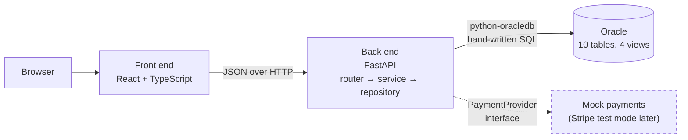

# Card Shop

A single-seller trading-card storefront, built on a relational database designed from
scratch: one seller lists their own physical cards, and guests buy them without creating
an account.

The database is the heart of the project, not an afterthought behind an ORM. Ten tables
model the difference between *a card*, *one physical copy of that card*, and *what is
for sale*; every page of the site reads through a database view; and the SQL behind each
feature is hand-written and visible in a repository layer. [`database/README.md`](database/README.md)
maps each feature to the objects it uses.

> **Status:** feature-complete, tested and running under CI. A guest can buy a card
> end to end; the seller can manage inventory, photos, orders, dispatch and reports.
> Deployment to AWS is designed but not built.
> See [Project status](#project-status).

## Contents

- [Architecture](#architecture)
- [Data model](#data-model)
- [Tech stack](#tech-stack)
- [Repository layout](#repository-layout)
- [Running it locally](#running-it-locally)
- [Environment variables](#environment-variables)
- [Project status](#project-status)
- [License](#license)

## Architecture



The dashed box is designed but not yet implemented.

Three deliberate choices shape the design:

- **Guest checkout only.** There are no customer accounts. A customer is one row keyed
  by email address, and an order is looked up with a random public reference plus that
  email — so nothing to sign up for, and no buyer passwords to store.
- **Reservation, then payment.** Creating an order locks the chosen listings with
  `SELECT … FOR UPDATE`, confirms each is still active, and moves them to `Reserved`,
  all in one transaction — so two buyers can never pay for the same physical card.
  Abandoned checkouts are released from the reservation when the next one runs.
- **Payments behind an interface.** Checkout talks to a `PaymentProvider`, whose first
  implementation is a mock. Adding Stripe test mode later means a new provider class and
  a webhook route: no schema change, and no change to order logic. A unique constraint
  on one payment per order already makes recording a payment idempotent, so a
  double-clicked Pay button is rejected by the database.

## Data model

Every read the site performs goes through a view rather than an ad-hoc join, and
surrogate keys come from sequences wired in as column defaults. Business rules that
must always hold — a positive asking price, a valid card condition, one payment per
order, a delivery date no earlier than its shipment — are check and unique constraints,
enforced by the database rather than trusted to application code.

The schema lives in [`database/schema/`](database/schema), applied in filename order and
append-only: each change is a new numbered file whose header records what changed, why,
and which existing object was considered for reuse first.

**See [`database/README.md`](database/README.md)** for the object inventory, the change
log, the feature-to-database mapping, and the demo script.

## Tech stack

| Layer | Choice | Notes |
| --- | --- | --- |
| Front end | React + TypeScript | Build tooling and styling not yet chosen |
| Back end | Python + FastAPI | Layered router → service → repository |
| Data access | `python-oracledb` | Hand-written SQL, bind variables only, no ORM |
| Database | Oracle Free 23 (`gvenzl/oracle-free:23-slim`) | Service `FREEPDB1`, app schema `cardshop` |
| Local dev | Docker Compose | Database persists in a named volume |
| Deployment | AWS EC2 (planned) | Connection details fully environment-configurable |

## Repository layout

```
.
├── backend/         FastAPI application
│   ├── app/
│   │   ├── api/         routers
│   │   ├── services/    business logic
│   │   ├── repositories/ database access
│   │   ├── schemas/     request and response models
│   │   └── sql/         the SQL itself, one .sql file per statement
│   └── tests/
├── database/
│   ├── README.md    object inventory, feature mapping, demo script
│   ├── schema/      numbered DDL, applied in filename order
│   ├── seed/        sample data and the seller's live inventory
│   ├── init/        first-boot loader, run by the container entrypoint
│   └── checks/      re-runnable sanity check
├── docker-compose.yml
├── .env.example     template for local configuration
└── CHANGELOG.md     what changed, step by step, and why
```

## Running it locally

**Requirements:** Docker Desktop, and roughly 2 GB of free RAM for the database
container. Commands below are PowerShell; they work unchanged in bash.

**1. Configure.** Copy the template and fill in your own passwords. `.env` is gitignored
and must never be committed.

```powershell
Copy-Item .env.example .env
```

`APP_USER_PASSWORD` should contain letters and digits only — `@`, `/` and `"` break the
connection strings used by the loader.

**2. Start the database.** The first boot creates the schema user, applies every file in
`database/schema/` and then every file in `database/seed/`, and takes a couple of
minutes. Later starts are fast and skip all of it.

```powershell
docker compose up -d db
docker compose logs -f db
```

Wait for:

```
[cardshop-init] SUCCESS: schema and seed data loaded
DATABASE IS READY TO USE!
```

**3. Check it.** Asserts the object counts, that the catalogue views agree row for row,
and that sequence defaults work. Safe to re-run:

```powershell
docker exec cardshop-db bash -c 'sqlplus -s $APP_USER/$APP_USER_PASSWORD@//localhost/FREEPDB1 @/opt/cardshop/database/checks/verify.sql'
```

**4. Open a SQL prompt**, to look around:

```powershell
docker exec -it cardshop-db bash -c 'sqlplus $APP_USER/$APP_USER_PASSWORD@//localhost/FREEPDB1'
```

### Running the backend

Requires [uv](https://docs.astral.sh/uv/). From `backend/`:

```powershell
uv sync                 # creates .venv and writes uv.lock
uv run pytest           # unit tests, no database needed
uv run uvicorn app.main:create_app --factory --reload
```

Or bring the whole stack up, which waits for Oracle to be healthy first:

```powershell
docker compose up -d --build
curl http://localhost:8000/api/health
```

A healthy response is `{"status":"ok","database":"ok"}`. If the database cannot be
reached the same endpoint returns `503` and `{"status":"degraded","database":"unreachable"}`,
so a load balancer or compose healthcheck can tell the difference. Interactive API docs
are at `/docs` when `APP_ENV=dev`.

Integration tests run against the live stack:

```powershell
uv run pytest -m integration
```

### Resetting the database

The loader runs on a *first* boot only, so applying a schema or seed change today means
discarding the volume and rebuilding. **This destroys all local data:**

```powershell
docker compose down -v
docker compose up -d db
```

A migration runner that applies changes without wiping data is planned before any
production deployment.

## Environment variables

Every value is read from the environment; nothing is hardcoded. Add any new variable to
`.env.example` with a placeholder and a comment.

| Variable | Purpose | Local value |
| --- | --- | --- |
| `ORACLE_PASSWORD` | Container admin (`SYS`/`SYSTEM`) password | your choice |
| `APP_USER` | Schema that owns every application object | `cardshop` |
| `APP_USER_PASSWORD` | That schema's password; letters and digits only | your choice |
| `DB_HOST` | Database host | `localhost` |
| `DB_PORT` | Published database port | `1521` |
| `DB_SERVICE` | Oracle service name | `FREEPDB1` |

## Project status

**Done**

- Project structure, a Docker Compose database service with a persistent volume and
  health check, and a first-boot loader that applies schema and seed files as the
  least-privilege app user rather than as `SYS`.
- Schema support for the application, kept to the minimum the existing tables could not
  provide: sequence-backed ID defaults, a card photo URL on each physical copy, a random
  public order reference for guest lookup, and one catalogue view built on top of the
  existing active-listings view. Seller inventory seeded.
- Back end skeleton: typed configuration from the environment, an Oracle connection pool
  in thin mode, `GET /api/health` reporting real database connectivity, structured error
  handling, environment-aware logging, unit and integration test suites, a container
  image, and a `backend` service that waits for the database to be healthy.
- Catalogue API: five read endpoints over the graded views - search with eight filters
  and four sort orders, paginated; featured cards; card detail; and the set and
  filter-option lists.
- Checkout: a client-side cart, transactional order creation that locks each listing
  with `SELECT … FOR UPDATE`, mock payment behind a `PaymentProvider` interface,
  guest order lookup by reference and email, and reservations that lapse after 30
  minutes. 71 backend tests, 41 of them against a real database, including two
  concurrency tests that prove one card cannot be sold twice.
- Seller admin: argon2id sign-in with an httpOnly session cookie and sign-in
  throttling, add a card with optional grading, reprice, attach photos, disable or
  delete a listing, and record dispatch and delivery. 115 backend tests, 63 of them
  against a real database.

**Next**

- **Migration runner** — a small script and a `schema_migrations` table, applying only
  not-yet-applied schema files, including baselining a database built by the loader.
- **Production configuration and deployment** — static front-end build behind a reverse
  proxy, HTTPS, locked-down CORS and security headers, secrets handling, backups, and a
  deployment to AWS EC2 with a documented rollback.

## License

MIT — see [LICENSE](LICENSE).
